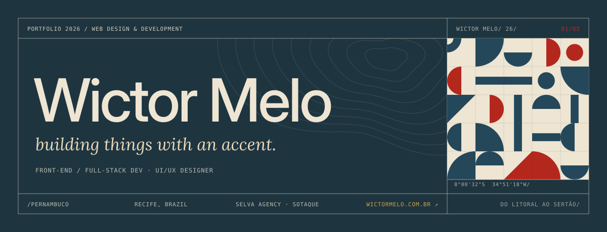
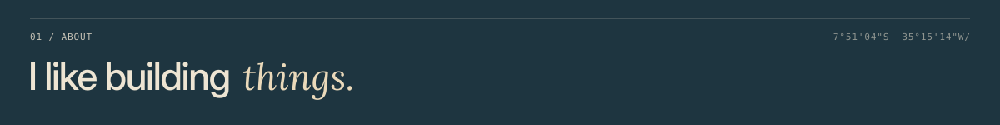
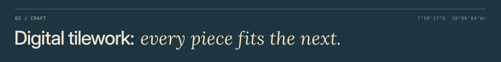
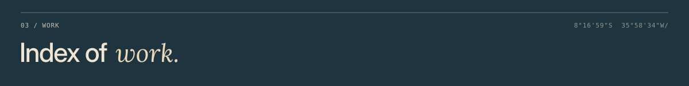
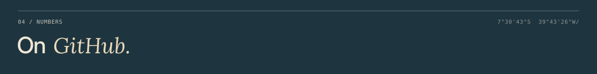
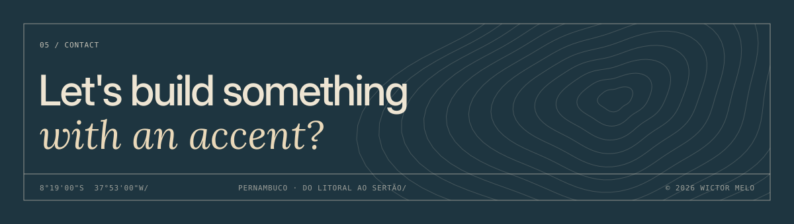

  
  
  
  
  

Sometimes it's an interface, sometimes an app, sometimes a whole system you only notice when it stops working. Almost always, something I didn't know how to do yet when I started.

I'm a digital solutions developer at **SELVA Agency**: I build sites in WordPress, Webflow, Wix and Shopify, connect CRMs and e-commerce stores with n8n, APIs and webhooks, and set up hosting, domains and DNS. Outside work, I build products in small teams, at hackathons and in university projects — usually sitting between design and code. With my sister, I run **Sotaque**, a design and development studio that makes custom sites and systems.

<table>
  <tr><td><code>ROLE</code></td><td>Front-end / full-stack dev · UI/UX designer</td></tr>
  <tr><td><code>BASED IN</code></td><td>Recife, Pernambuco 🇧🇷</td></tr>
  <tr><td><code>NOW</code></td><td>Digital Solutions Developer · SELVA Agency</td></tr>
  <tr><td><code>STUDIO</code></td><td>Sotaque · co-founder</td></tr>
  <tr><td><code>EDUCATION</code></td><td>Systems Analysis &amp; Development · Faculdade Nova Roma, 2027</td></tr>
  <tr><td><code>TECHNICAL</code></td><td>Computer Networks · ETEMERB</td></tr>
  <tr><td><code>ROOTS</code></td><td>Born in Olinda, raised in Carpina</td></tr>
</table>

Interface, code, automation and infrastructure — a panel that only makes sense as a whole.

| | Craft | Pieces |
|:--|:--|:--|
| `01` | **Front-end** | React · React Native · JavaScript · TypeScript · HTML · CSS · responsive UI |
| `02` | **Back-end** | Node.js · REST APIs &amp; webhooks · PHP · Python · C |
| `03` | **AI &amp; automation** | Claude Code · front-ends for AI products · n8n |
| `04` | **Design** | UX/UI · Figma · Photoshop · Illustrator · Adobe Creative Suite |
| `05` | **Platforms &amp; infra** | WordPress · Webflow · Wix · Shopify (Liquid) · WooCommerce · HubSpot · hosting, DNS &amp; networks |

  

<code>10 PROJECTS · 2023 → 2026</code>

| No. | Project | Role | Period |
|:--|:--|:--|:--|
| `01` | Circular economy | Dev · Design · Pitch | May 2023 → now |
| `02` | Networking for artists | UI · Identity · Front-end | Jul 2024 → Nov 2025 |
| `03` | AI-powered programming | Co-founder · UX/UI · Front-end | Aug 2024 → Dec 2025 |
| `04` | Sustainability &amp; gamification | UX/UI · Identity · Front-end | Feb → Mar 2025 |
| `05` | Community engagement | UI · Identity · Front-end | Nov → Dec 2024 |
| `06` | Events &amp; trails | UX/UI · Identity | Dec 2024 |
| `07` | School levelling | UX/UI · Identity | Oct 2024 |
| `08` | Institutional site · ASP-PE | Volunteer web dev | Jan → Mar 2025 |
| `09` | Cinema web app · personal | Product · Design · Full-stack | Sep 2026 → now |
| `10` | Book club · personal | Product · Design · Full-stack | Sep 2026 → now |

Full case studies at <a href="https://www.wictormelo.com.br/">wictormelo.com.br ↗</a>

**Honors**

| | |
|:--|:--|
| 🥇 `1st` | **Hedera HelloFuture Hackathon** — winning team with Ágora, international hackathon · 2024 |
| 🥈 `2nd` | **Hacker Cidadão 12.0** — Copiba, socio-environmental impact with AI · 2025 |
| 🏛️ `4/34` | **GovTech Open Innovation Call** — Recria project approved |
| 🌱 `Incubation` | **PoloTec UFPE** — Ágora accepted into pre-incubation · 2025 |
| 🎤 `Stage` | **Rec'n'Play 2024** — Munganga presented at the festival |

  
  

  

